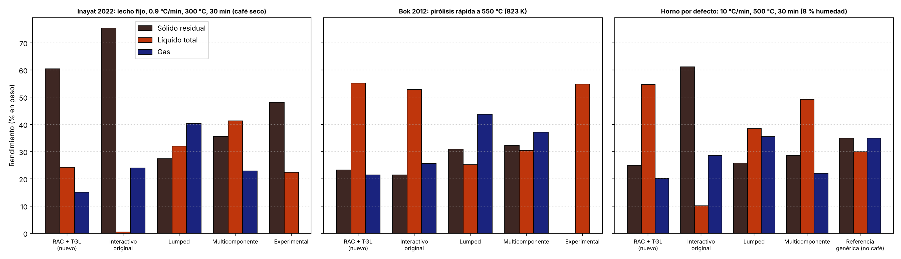
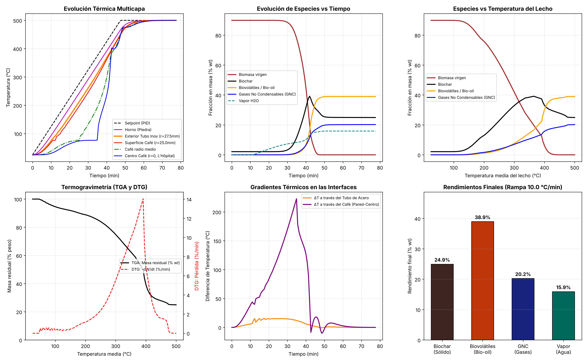

# Evaluación de las cinéticas de pirólisis del café

Proyecto: reactor de pirólisis de residuos de café (SCG), horno eléctrico con canastilla.
Fecha: 2026-10-28. Rama: `claude/determined-curie-2btbhr`.

Aquí recojo lo que encontré al revisar el simulador. Por un lado, por qué no cerraba el balance de masa; por otro, qué tan cerca de la realidad están las tres cinéticas que tenía el repo y qué cambié para acercarme a datos medidos con café.

## ¿Qué quería saber?

1. ¿Por qué la suma de rendimientos no me daba 100 % cuando cambiaba la masa de la canastilla?
2. ¿Cuál cinética se parece más a la pirólisis real, sobre todo a la rápida?
3. ¿Qué tan lejos están mis modelos de los resultados experimentales con café?

## 1. ¿Por qué el modelo no "cerraba"?

No era un solo error; eran tres que se sumaban en `simulador_interactivo.py`.

**Inestabilidad numérica.** El paso de tiempo se calculaba solo con las propiedades del café. El tubo de acero conduce unas 20 veces más rápido que el café y sus nodos son más finos (0.625 mm contra 1.92 mm), entonces el número de Fourier del acero quedaba en 3.18; el límite del esquema explícito es 0.5. La temperatura oscilaba, crecía sin control y terminaba en NaN con cualquier configuración. Si la temperatura es NaN, la suma de rendimientos no puede dar 100 %.

**El calor se perdía en la interfaz café/acero.** El café recibía calor a través de la resistencia de contacto (unos 90 W/m²K), pero el acero lo entregaba con `k_acero/dr` (unos 26 000 W/m²K). Es decir, el acero perdía casi 300 veces más calor del que el café recibía. Este error ya existía; no se veía porque la simulación explotaba antes. Con el paso de tiempo corregido, el lecho casi no se calentaba y el 90 % de la biomasa quedaba sin reaccionar.

**Faltaban términos en la suma.** La biomasa que no alcanzaba a reaccionar y la humedad que no se evaporaba no aparecían en el total. En los modelos de `python/` pasaba lo mismo con el agua: con una canastilla de R = 60 mm la suma daba 95.2 %.

Qué cambié:

- Paso de tiempo estable calculado en cada paso para todos los nodos, acero incluido.
- Cinética integrada de forma exacta: en cada paso se consume `B·(1 - e^(-k·dt))` y esa masa se reparte entre los productos. No se puede consumir más de lo que hay, entonces la masa se conserva "por construcción", sin recortar negativos con `np.maximum`.
- El acero cede exactamente el mismo flujo que recibe el café (nodo fantasma).
- El horno avanza con el `dt` real del paso (antes eran 0.4 s fijos por paso).
- El balance incluye biomasa y humedad sin reaccionar.

Verificación: `tests/test_balance_masa.py` corre 16 casos con las dos cinéticas y todos cierran el balance con error menor a 0.01 %. Los casos cubren:

- Canastilla: radio de 10 a 60 mm, altura de 20 a 40 cm.
- Pared de acero: de 1 a 6 mm.
- Humedad: de 8 a 40 %.
- Temperatura final: de 300 a 700 °C; rampas de 5 a 50 °C/min.

## 2. ¿Mi horno hace pirólisis rápida o lenta?

Antes de escoger cinética, encuentro que hay que tener clara esta diferencia, porque cambia todo.

La pirólisis rápida no es lo mismo que calentar rápido el horno. Necesita que cada partícula se caliente a cientos de °C por segundo, partículas finas y que los vapores salgan en segundos; eso se logra en lecho fluidizado o en tornillo. Según la revisión que cita Inayat et al. (2022), la pirólisis lenta va a menos de 1 °C/s y la rápida entre 1 y 1000 °C/s.

Una canastilla empacada en un horno con rampa de 5 a 20 °C/min es **pirólisis lenta**. Mi propia simulación lo muestra: entre la pared y el centro del lecho hay hasta 220 °C de diferencia, y el centro se queda cerca de 78 °C mientras se seca.

Por eso considero que la pregunta útil no es "¿cuál cinética es la de pirólisis rápida?", sino "¿cuál cinética predice bien los dos regímenes?". Con eso puedo simular mi horno (lento) y también saber qué daría el café en un reactor rápido.

## 3. ¿Qué modelos cinéticos hay en la literatura?

| Familia | Idea | ¿Sirve para rápida y lenta? |
|---|---|---|
| Una reacción global | Biomasa → volátiles + char con rendimientos fijos | No: el reparto no cambia con la velocidad de calentamiento |
| Competitivas tipo Shafizadeh-Chin / Thurner-Mann (1980) | Biomasa → gas, alquitrán y char en paralelo, con energías de activación distintas | Sí, en tendencia, pero sin composición de la biomasa |
| DAEM | Distribución de energías de activación, muy usada para ajustar TGA | Ajusta bien la pérdida de masa, no dice qué productos salen |
| Ranzi / CRECK (Bio-PoliMi), Ranzi et al. 2008 | La biomasa es una mezcla de celulosa, hemicelulosa y tres ligninas; cada una con reacciones que compiten | Sí: validado en TGA (lento) y en reactores de caída libre y lecho fluidizado (rápido) |
| RAC, Anca-Couce 2017 | CRECK + carbonización secundaria heterogénea (parámetros "x") | Sí, y además se aplicó a lecho fijo, que es mi caso |
| Extractivos, Debiagi et al. 2015 | Agrega triglicéridos (TGL) y taninos a CRECK | Necesario para el café, que tiene unos 15 % de aceite |

Una advertencia de la literatura: una comparación de modelos (Pielsticker) encontró que CRECK tiende a sobreestimar la velocidad de liberación de volátiles, sobre todo a baja temperatura y en la lignina.

## 4. ¿Cómo eran las tres cinéticas que tenía el repo?

Calculé la fracción de biomasa que se va a cada producto en cada temperatura (selectividad instantánea [char, bio-oil, gas]):

| T | Lumped | Interactivo original |
|---|---|---|
| 300 °C | 0.26 / 0.34 / 0.40 | 0.63 / 0.03 / 0.34 |
| 400 °C | 0.27 / 0.36 / 0.37 | 0.43 / 0.18 / 0.39 |
| 500 °C | 0.28 / 0.37 / 0.34 | 0.23 / 0.46 / 0.31 |
| 600 °C | 0.29 / 0.39 / 0.33 | 0.11 / 0.70 / 0.20 |

**Interactivo original** (`simulador_interactivo.py`). Tiene la estructura correcta (reacciones que compiten, más bio-oil a mayor temperatura), pero los parámetros no tienen fuente y el char secundario depende de la rampa con una fórmula hecha a mano. A 10 °C/min daba 61 % de char y 2 % de bio-oil, lo cual no cuadra con ningún dato de café.

**Lumped** (`python/kinetics_lumped.py`). Las tres reacciones tienen casi la misma energía de activación (118 a 122.5 kJ/mol), entonces el reparto es casi plano (entre 26 y 40 %) a cualquier temperatura. No puede distinguir pirólisis lenta de rápida.

**Multicomponente** (`python/kinetics.py`). Tiene la composición correcta del café (celulosa, hemicelulosa, lignina, lípidos y craqueo de alquitranes), pero cada componente se reparte con rendimientos fijos; la velocidad de calentamiento no cambia el resultado primario. Además, la composición suma 92.31 % en base seca: si cargo 380 kg/m³, el modelo simula unos 353.

## 5. ¿Qué implementé?

`python/kinetics_rac.py` tiene el esquema RAC 2017 completo (25 reacciones; R4 no existe en el esquema) más la reacción de triglicéridos de Debiagi et al. (2015):

```
TGL → acroleína + 3 FFA        A = 7×10^12 s^-1,  E = 45 700 kcal/kmol (191.2 kJ/mol)
```

Cómo funciona:

- Las especies sólidas (CELL, HCE, LIG-C/H/O, intermedios, gases atrapados G{...}, CHAR, TGL) se guardan en cada nodo del lecho.
- Los volátiles se agrupan en lo que se mide en laboratorio: **gas** (H2, CO, CO2, CH4, C2H4), **agua de reacción** y **bio-oil orgánico** (el resto de condensables, incluidos acroleína y ácidos grasos).
- Carbonización secundaria con los parámetros "x" del esquema: `lecho_fijo` (x alto: canastilla, rampa lenta, sin azúcares) y `rapida` (x bajo, con levoglucosano y xilosa).
- Calor de reacción por reacción (kJ/g), con la convención del esquema: positivo = endotérmico.
- Las 26 reacciones quedan balanceadas exactamente en C, H y O. Esto lo revisa una prueba automática; si alguien copia mal un coeficiente, la prueba falla.

Quedó como cinética por defecto del simulador (`'cinetica': 'rac'`). La original se puede seguir usando con `'cinetica': 'original'` para comparar.

## 6. ¿Funciona? Validación con café

Para comparar solo la química, sin el efecto del reactor, uso una muestra delgada a la que le impongo la temperatura, como en un TGA (`python/comparar_cineticas.py`). El "sólido residual" es lo que se pesa en el laboratorio: biochar más lo que no reaccionó. "Líquido total" es bio-oil orgánico más agua.

### Caso 1. Lecho fijo de acero, café seco, ~0.9 °C/min hasta 300 °C, 30 min (Inayat et al. 2022)

| Modelo | Sólido residual (%) | Líquido total (%) | Gas (%) |
|---|---|---|---|
| RAC + TGL (nuevo) | 60.5 | 24.3 | 15.2 |
| Interactivo original | 75.5 | 0.5 | 24.0 |
| Lumped | 27.4 | 32.1 | 40.5 |
| Multicomponente | 35.7 | 41.4 | 22.9 |
| Experimental | 48.2 | 22.5 | = ? |

### Caso 2. Pirólisis rápida a 550 °C / 823 K (Bok et al. 2012)

| Modelo | Sólido residual (%) | Líquido total (%) | Gas (%) |
|---|---|---|---|
| RAC + TGL (nuevo) | 23.3 | 55.2 | 21.5 |
| Interactivo original | 21.5 | 52.8 | 25.7 |
| Lumped | 31.0 | 25.2 | 43.8 |
| Multicomponente | 32.3 | 30.5 | 37.2 |
| Experimental | = ? | 54.85 | = ? |

### Caso 3. Mi horno por defecto: 10 °C/min, 500 °C, 30 min, 8 % humedad

| Modelo | Sólido residual (%) | Líquido total (%) | Gas (%) |
|---|---|---|---|
| RAC + TGL (nuevo) | 25.0 | 54.7 | 20.2 |
| Interactivo original | 61.2 | 10.1 | 28.7 |
| Lumped | 25.8 | 38.6 | 35.6 |
| Multicomponente | 28.6 | 49.3 | 22.1 |
| Referencia genérica de pirólisis lenta (no es café) | ≈35 | ≈30 | ≈35 |



Error contra el experimento (puntos porcentuales):

| | RAC (nuevo) | Interactivo original | Lumped | Multicomponente |
|---|---|---|---|---|
| Líquido, lecho fijo (Inayat) | **+1.8** | -22.0 | +9.6 | +18.9 |
| Sólido, lecho fijo (Inayat) | +12.3 | +27.3 | -20.8 | -12.5 |
| Líquido, rápida (Bok) | **+0.35** | -2.05 | -29.65 | -24.35 |

¿Qué concluyo? RAC es el único que acierta en los dos regímenes. El interactivo original acierta en rápida, pero falla por completo en lenta, que es justo lo que hace mi horno. El lumped y el multicomponente no reproducen la pirólisis rápida.

¿Dónde falla RAC? En el sólido a 300 °C sobran unos 12 puntos. Revisé qué queda sin reaccionar: 15.2 % es aceite (TGL), 6.2 % celulosa y 2.7 % lignina. La cinética de TGL de Debiagi está ajustada con aceites de soya y maíz, que se descomponen por encima de unos 350 °C. Mis hipótesis: el café de Inayat tenía menos aceite que el mío, o parte del aceite del café se evapora o se descompone antes de 300 °C. Sin un TGA de mi café no lo puedo saber. El reparto de lignina pesa poco (unos 2 puntos entre madera dura y blanda).

En el caso 3, RAC da más líquido que la referencia genérica (54.7 contra ≈30 %). Considero que esto tiene sentido para el café, porque tiene 15 % de aceite que sale casi todo como líquido, pero hay que confirmarlo con el experimento; la referencia no es de café.

## 7. ¿Qué pasa en el reactor completo?

Con el simulador 2D (canastilla de R = 25 mm y L = 20 cm, tubo de acero de 2.5 mm, 10 °C/min hasta 500 °C, 30 min, cinética RAC en régimen `lecho_fijo`):

- Biochar 24.9 %, bio-oil orgánico 38.9 %, gas 20.2 %, agua (humedad + reacción) 15.9 %. Balance 100.00 %.
- El centro del lecho se queda en unos 78 °C mientras se seca (minutos 25 a 35) y después sube rápido.
- Entre los minutos 40 y 45 el centro llega a estar más caliente que la pared. Es la carbonización secundaria, que es exotérmica; es un efecto conocido en lechos fijos y lo puedo verificar con un termopar en el centro de la canastilla.
- Tarda unos 65 s en correr (antes unos 20 s con la cinética original).



## 8. Supuestos y lo que no sé

- Composición del café: celulosa 12 %, hemicelulosa 35 %, lignina 28 %, lípidos 15 %, cenizas 2.31 % (base seca, GIEM + FTIR). Suma 92.31 %; el 7.7 % restante = ? (proteínas, extractivos). **Supuesto:** lo reparto en proporción a los componentes conocidos, porque el esquema RAC no tiene cinética de proteínas.
- Reparto de la lignina en LIG-C / LIG-H / LIG-O = ? No tengo análisis elemental (C, H, O) del café. **Supuesto:** uso el reparto de madera dura del esquema RAC (6 / 7 / 9 de 22).
- Acetilos de la hemicelulosa = ?. **Supuesto:** 0.1 (valor de madera blanda), porque los galactomananos del café son poco acetilados.
- Calor de reacción del TGL = ?. Debiagi no lo reporta. **Supuesto:** 0.
- No incluye el craqueo homogéneo de alquitranes en fase gas, que importa por encima de unos 500 °C (el esquema RAC tampoco lo incluye).
- La evaporación de la humedad usa la misma ley de Arrhenius que el resto del proyecto (sin fuente).
- Inayat et al. reporta "~0.9 °C/min" y 30 min a 300 °C; no sé si el sólido que reporta incluye cenizas. Bok et al. no aclara en el resumen si el 54.85 % incluye agua.

## 9. Próximos pasos

1. **TGA del café con el GIEM** (10 °C/min, N2, hasta 700 °C). Es lo que más reduce la incertidumbre: me dice cuándo se va el aceite y si sobran los 12 puntos de sólido.
2. **Análisis elemental (C, H, O)** para calcular el reparto de lignina con el método de Ranzi/Debiagi en vez de suponerlo.
3. **Termopar en el centro de la canastilla** para comparar con el perfil simulado (meseta de secado y exoterma).
4. Unificar los tres modelos en un solo motor con RAC y llevar todos los parámetros a la interfaz (siguiente etapa del proyecto).
5. Si las simulaciones con pared delgada se vuelven lentas, pasar la conducción a un esquema implícito.

## Cómo correrlo

```bash
pip install -r requirements.txt pytest
python -m pytest tests -v                 # balance de masa + cinética RAC (unos 4 min)
cd python && python comparar_cineticas.py # tablas y figura de la sección 6
cd .. && python simulador_interactivo.py  # reactor 2D; Enter usa los valores por defecto
```

Archivos:

| Archivo | Qué tiene |
|---|---|
| `python/kinetics_rac.py` | Cinética RAC + TGL, con fuentes y supuestos en el encabezado |
| `python/comparar_cineticas.py` | Comparación 0D de las cuatro cinéticas contra los experimentos |
| `simulador_interactivo.py` | Reactor 2D con tubo de acero; cinética `rac` por defecto |
| `tests/test_balance_masa.py` | 16 casos de balance de masa (los tres modelos) |
| `tests/test_cinetica_rac.py` | Balance atómico, conservación de masa y validación con café |

## Fuentes

- Ranzi, E. et al. (2008). Chemical Kinetics of Biomass Pyrolysis. *Energy & Fuels*, 22(6), 4292-4300. doi:10.1021/ef800551t. [Repositorio Polimi](https://re.public.polimi.it/handle/11311/548367)
- Anca-Couce, A. (2017). RAC detailed scheme for biomass pyrolysis, TU Graz. [PDF](https://www.tugraz.at/fileadmin/user_upload/Institute/IWT/AG_EG/Biomasse/RAC_pyrolysis_scheme_2017.pdf). Reacciones tomadas de Anca-Couce, Sommersacher y Scharler (2017), *J. Anal. Appl. Pyrolysis*, 127, 411-425, y Anca-Couce y Scharler (2017), *Fuel*, 206, 572-579.
- Debiagi, P. et al. (2015). Extractives Extend the Applicability of Multistep Kinetic Scheme of Biomass Pyrolysis. *Energy & Fuels*, 29(10), 6544-6555. doi:10.1021/acs.energyfuels.5b01753. [PDF Polimi](https://re.public.polimi.it/retrieve/handle/11311/970707/432893/Extractives%20Extend%20the%20Applicability%20of%20Multistep%20Kinetic%20Scheme_11311-970707_Frassoldati.pdf)
- Inayat, A. et al. (2022). Activated Carbon Production from Coffee Waste via Slow Pyrolysis Using a Fixed Bed Reactor. *Environmental and Climate Technologies*, 26(1), 720-729. doi:10.2478/rtuect-2022-0055
- Bok, J. P. et al. (2012). Fast pyrolysis of coffee grounds: Characteristics of product yields and biocrude oil quality. *Energy*, 47(1), 17-24. [Resumen](https://ideas.repec.org/a/eee/energy/v47y2012i1p17-24.html)
- Comparación SFOR, CRECK y Bio-CPD (Pielsticker et al.). [Registro](https://research.nottingham.edu.cn/en/publications/comparative-analysis-of-pyrolysis-models-including-sfor-creck-and/)
- Pirólisis rápida de borra de café en lecho fluidizado (2023). *Case Studies in Chemical and Environmental Engineering*. [DOAJ](https://doaj.org/article/14a71d81252747deafb29b606f68c9b9)
